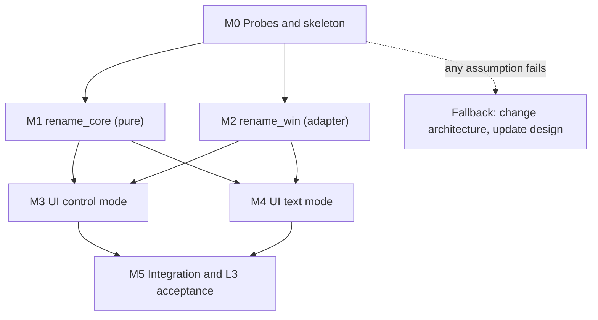

# ra9fael.rename Development Plan (Proposal)

**Status: M0–M5 executed; host integration unverified.** Bilingual links: [涓枃](DEVELOPMENT-PLAN.md) · [README](README.en.md) · [Design](plugin-design.en.md) · [UI specification](UI-SPEC.en.md) · [Test plan](TEST-PLAN.en.md) · [Implementation validation](docs/validation/rename-m0-20261110/IMPLEMENTATION.en.md).

This plan sequences the design's 20 `RN-FR` requirements and the test plan's 46 cases into executable milestones. Requirement and case IDs are referenced, never redefined here.

## 0. Execution state

| Milestone | State | Evidence |
|---|---|---|
| M0 probes and skeleton | **code in place, assumptions unverified** | the probe compiles; none of the six host assumptions has been measured |
| M1 `rename_core` pure core | **done** | 85 L1 cases green |
| M2 `rename_win` adapter | **done** | 14 real-rename e2e assertions green |
| M3 UI control mode | **logic done, Qt never compiled** | `Presenter` is unit-tested; the Qt window has never been built |
| M4 UI text mode | **logic done, Qt never compiled** | same |
| M5 metadata and finishing | **metadata implemented, not verified end to end** | no test image |

M1/M2 are delivered capability. M3/M4 are "logic tested, rendering unverified". M0's six assumptions are **the only thing blocking a release**.

## 1. Upfront choices

Decided. Numbers were checked against the workspace, not extrapolated.

| Item | Choice | Basis |
|---|---|---|
| Language standard | C++20 | `ra9fael.diskview` already uses it (`CMakeLists.txt` L4); most other plugins still use 17. The core needs `std::wstring::contains` and three-way comparison, so 17 is not worth it |
| Build | CMake 鈮?3.21 + MSVC v143 | Every plugin in the workspace uses 3.21 (`findmouse`, `diskview`, 鈥?; do not raise to 3.28 and fork from them |
| UI | Qt Quick (QML) + C++ backend | The host shared Qt contract guarantees only Core/Gui/Qml/Quick/`Controls.Basic` |
| Qt runtime | `runtime.qt: "host"`, 6.12 | The host `plugins.md` shared Qt contract; `minWinShun: 0.22.0` as in `findmouse` |
| Pure-core tests | The workspace's own `tests/test_harness.h` | **No Catch2.** `ra9fael.volume`/`cursorwrap`/`bright` all use this dependency-free harness (Catch2-style `TEST_CASE`/`CHECK`); `enable_testing()` + `add_test` registers it with ctest |
| Execution backend | `IFileOperation` | Design RNF-14; no self-built recovery journal |

**Test registration follows `findmouse`**: `enable_testing()` plus `add_test(NAME rename_core COMMAND rename_tests ...)`, run with `ctest --test-dir build`.

**Decided: M3 and M4 run serially.** They share one QML skeleton and `plugin.json`, so running them in parallel only creates repeated conflicts on the same files; serial costs far less than merging.

**Decided: release one ships metadata templates (RN-FR-16)**, placed last inside M5. It is the only feature pulling in the WIC dependency and an 8-format compatibility matrix, and front-loading it would pollute M1's pure-core test surface. If M5 runs short, it is the one item that can be cut whole without affecting other requirements.

## 2. Milestone dependencies

## 3. M0: probes and skeleton

**Why first**: six assumptions in the design are marked unverified. If any one fails, the architecture changes, and the later it is discovered the higher the cost. This phase writes probes only, no product code.

| # | Assumption | Probe | Fallback |
|---|---|---|---|
| P1 | The host `files` trigger reaches the plugin | Minimal resident plugin logging `triggers.files` to stderr; multi-select in Explorer | Fall back to a keyword entry and re-evaluate the product shape |
| P2 | The shared Qt works for this plugin | Minimal QML window plus `appearance` message handling | Bundle its own Qt, larger package |
| P3 | `IFileOperation` can rename from inside the plugin process | Rename one file; observe elevation and the undo stack | Switch to `MoveFileEx` plus a self-built journal; the design must be rewritten |
| P4 | How the elevation prompt actually appears | Rename a file under a protected directory | Intercept up front and report clearly |
| P5 | Real behaviour of the 32000-character `files` cap | Select about 800 long-path files at once | Batching strategy |
| P6 | WIC metadata readable inside the plugin | Read EXIF from one JPG | Defer metadata templates to P1 later |

**Deliverables**: probe sources (task-level; trimmed to key excerpts per `DEVELOPMENT.md` 搂4.1 after verification) 路 `rename-probes-<date>/` with the validation document and raw logs 路 `package/plugin.json` skeleton 路 `CMakeLists.txt` and the `core/` `win/` `ui/` `tests/` skeleton.

**Gate**: P1鈥揚3 must all pass before M1/M2. Any failure means going back to the design document to change the architecture rather than pushing on regardless.

## 4. M1: `rename_core` pure core

**Hard constraint**: this directory **must not include any Windows or Qt header**. That is the physical basis for running L1 on any platform and for letting both modes share the finalization logic. The gate is an executable check: `grep -r` for `windows.h` and `Qt` must come back empty.

| Order | Module | Content | Cases |
|---|---|---|---|
| 1 | `NameSplitter` | name/extension/full split and re-join | RN-T1-01, RN-T1-06 |
| 2 | `TrimNfcCompare` | finalization steps 1 and 3 | RN-T1-09, RN-T1-11 |
| 3 | `CaseTransform` | four transforms plus the Title Case exception list | RN-T1-12 |
| 4 | `StatusEvaluator` | five statuses, invalid characters, length delta | RN-T1-03, RN-T1-04 |
| 5 | `TemplateExpander` | date pattern table, negative lookahead, `$$` escaping | RN-T1-07, RN-T1-08 |
| 6 | `Counter` | batch-shared / chain-shared / advance only on match | RN-T1-10 |
| 7 | `RuleEngine` | single-step `Replace()` plus chained `Evaluate()` | RN-T1-01, RN-T1-02 |
| 8 | `OilParser` | `/<id>` anchor parsing, per-line errors | RN-T1-13, RN-T1-14 |
| 9 | `OilDiffer` | diff to Rename/Rejected; never emits Create/Delete | RN-T1-16, RN-T2-07 |
| 10 | `PlanBuilder` | assemble `PreviewPlan` plus `planId` | RN-T1-03 |
| 11 | fuzz targets | three-way regex split plus random buffer text | RN-T1-17 |

Steps 3鈥? underpin step 7 and must stay in order. Steps 8鈥? are fully independent of 1鈥? and **can run in parallel**.

**Gate**: RN-T1-01鈥?7 all green; fuzz runs its full budget with no crash or out-of-bounds access; `core/` contains no OS/Qt headers.

## 5. M2: `rename_win` adapter

| Module | Content | Cases |
|---|---|---|
| `FileEnumerator` | `files` path array to `ItemSnapshot`; optional recursion, dedup, no link following | RN-T2-04 |
| `MetadataProvider` | WIC EXIF/XMP, 8 extensions only, cached | RN-T1-05 |
| `ShellExecutor` | `IFileOperation`, deepest-first, no `RENAMEONCOLLISION`, cancellable | RN-T2-02, RN-T2-03, RN-T2-05 |
| `PreviewWorker` | dedicated cancellable thread, `planId` validation | RN-T2-01 |
| `JournalLite` | read-only batch journal for diagnostics only, no recovery | RN-T2-03 |

Implementation notes:

1. **Deepest-first**: compute depths and group, submit from the deepest layer to layer 0, then fix subtree paths after a parent renames.
2. **Identity re-check is the only safety net**: because `RENAMEONCOLLISION` is not used, conflicts must be refused before execution by comparing size/time/volume serial per item.
3. **No `FOF_RENAMEONCOLLISION`**: adding it would silently rename to `name (1)`, violating RN-FR-05.
4. **Use `QEventLoop` plus signals and slots** for the Qt message loop; do not copy PowerRename's `PeekMessage` pump.

**Gate**: RN-T2-01鈥?7 all green (fake `IFileOperation` plus a fake filesystem); deepest-first ordering has an assertable submission trace (RN-T2-05).

## 6. M3: UI control mode

Scope: main window skeleton and mode switch (text page stubbed) 路 rule row editor (scope / literal-regex / first-all / find / replace / add-remove / keyboard reordering) 路 flag panel (four case transforms, name-only, extension-only, exclude files/folders/subfolders, Enumerate) 路 preview table (selection / original name / match highlight / target name / status) 路 header-click filters 路 three-part action-bar counts, execution confirmation, undo entry 路 finalization notices ("trailing whitespace/dot removed", "contains NBSP, treated as a space").

**Gate**: wired to M1/M2 and able to complete one real rename; the whole flow reachable by keyboard (the manual prerequisite for RN-T4-04); no hardcoded theme colors.

## 7. M4: UI text mode (oil mode)

Scope: `QPlainTextEdit` monospace editor plus line gutter 路 non-editable `/<id>` prefix 路 300 ms debounced pre-check with inline error highlighting and trailing text notes 路 footer `N entries 路 M renames 路 K errors` 路 `Ctrl+S` 鈫?blocking checks 鈫?confirmation dialog 鈫?progress window 路 buffer reset and id reassignment on completion 路 clear messaging when external text is pasted.

**Decided serial**: M4 starts after M3 completes. Both share one QML skeleton, `plugin.json`, and the control-ID table in `plugin-design`, so parallel work would make every commit conflict on the same files.

Implementation notes:

1. **A non-editable `/<id>` is mandatory.** If a user edits it, the line becomes "no matching entry" and is voided.
2. **The id table must stay in sync**: after an undo, update the id-to-original-name mapping, or a second edit points at the old name.
3. **Scroll horizontally, never wrap**: wrapping breaks the one-entry-per-line parsing intuition.

**Gate**: RN-T1-13/14/15/16 behave identically on the real UI; RN-T3-05 passes; both modes assign the same status to the same name (RN-T2-06).

## 8. M5: integration and acceptance

1. Wire up mode switching (preserve selection; confirm before discarding uncommitted edits)
2. Preset save/load (rule chain plus flags)
3. Packaging: bilingual `plugin.json`, permission declarations, `minWinShun`
4. **Full L3 acceptance** (RN-T3-01鈥?5) 鈥?do not claim completion without it
5. L4 on real devices (RN-T4-01鈥?5): name swaps, case-only, Unicode, SMB, DPI, screen readers
6. L5 calibration and release (RN-T5-01/02)
7. Behavioural-difference regression (RN-T6-01鈥?8) 鈥?**must be all green**; any drift is a failure

## 9. Risk register

| Risk | Impact | Response |
|---|---|---|
| P1 fails: the `files` trigger is unavailable | The architecture's core is void | M0 comes first; failure returns to the design |
| `IFileOperation` misbehaves inside the plugin process | RN-FR-06/14/15 all change | P3 probe first; fallback is two-phase rename plus a journal |
| Shared Qt version drifts from the host | The plugin cannot start | Declare `minWinShun`; report a clear error rather than crashing on mismatch |
| Catastrophic regex backtracking | UI freeze | Worker thread plus cancellation; fuzz coverage |
| id table and buffer drift apart | Silent renaming of the wrong file | Per-item identity re-check before execution; the id table is the single truth |
| `IFileOperation` semantics differ over SMB | Data risk | Dedicated L4 case; refuse explicitly where unsupported |

## 10. Release-one boundaries (not doing)

Text-mode create/delete/move/link (RN-FR-19) 路 tree view 路 `Randomize` 路 AI naming (RN-FR-12, P2) 路 Explorer context-menu integration (RN-FR-13, P3 exploration only) 路 self-built recovery journal and two-phase rename (delegated to the Shell).

## 11. Decisions (previously pending)

1. **C++ standard and test framework**: C++20 plus the workspace's own `tests/test_harness.h`. **No Catch2** 鈥?the workspace already standardizes on a dependency-free harness, and adding a second framework would fork the CI and local commands.
2. **M3/M4 order**: serial. They share the QML skeleton and `plugin.json`, so parallel work would only conflict on the same files.
3. **Whether release one ships metadata templates (RN-FR-16)**: yes, but as the last item inside M5. It is the only feature pulling in the WIC dependency and the 8-format matrix, and front-loading it would pollute M1's pure-core test surface; if schedule is tight it is the one item that can be cut whole.

None of these affects M0: no probe depends on them.
