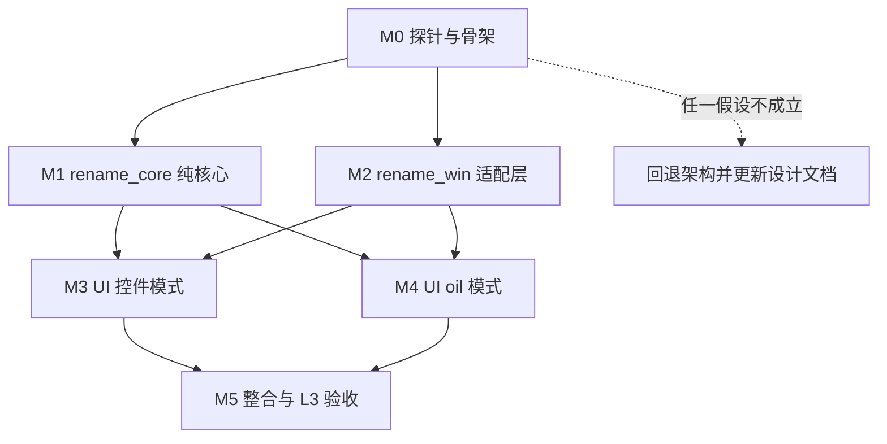

**状态：M0–M5 已执行；宿主集成未验证。** 中英互链：[English](DEVELOPMENT-PLAN.en.md) · [README](README.md) · [设计](plugin-design.md) · [UI 规格](UI-SPEC.md) · [测试计划](TEST-PLAN.md) · [实施验证](docs/validation/rename-m0-20261110/IMPLEMENTATION.md)。

本计划把设计的 20 条 RN-FR 与测试计划的 46 条用例排成可执行的里程碑。需求与用例编号不在此重复定义，只引用。

## 0. 执行状态

| 里程碑 | 状态 | 证据 |
|---|---|---|
| M0 探针与骨架 | **代码就位，假设未验证** | 探针编译通过；六条宿主假设一条未测 |
| M1 rename_core 纯核心 | **完成** | 85 条 L1 用例全绿 |
| M2 rename_win 适配层 | **完成** | 14 项真实改名 e2e 全绿 |
| M3 UI 控件模式 | **逻辑完成，Qt 未编译** | Presenter 有单元测试；Qt 窗口从未构建 |
| M4 UI 文本模式 | **逻辑完成，Qt 未编译** | 同上 |
| M5 元数据 + 收尾 | **元数据实现，未端到端验证** | 无测试图片 |

MoSCoW 上，M1/M2 是已交付能力；M3/M4 是「逻辑已测、渲染未验」；M0 的六条假设是**唯一阻塞发布的东西**。
## 0. 前置技术选型（需确认）

| 项 | 建议 | 依据 |
|---|---|---|
| 语言标准 | C++20 | 核心要 `std::wstring::contains`、`<=>`
| 构建 | CMake ≥ 3.28 + MSVC v143 | 与工作台其他 native 插件一致
| UI | Qt Quick (QML) + C++ 后端 | 宿主共享 Qt 契约保证 Core/Gui/Qml/Quick/Basic
| Qt 版本 | 6.12（`runtime.qt: "host"`） | 宿主 `plugins.md` 共享 Qt 契约
| 纯核心测试 | Catch2 v3 | 跨平台、无 OS 依赖，能在 CI 与本地跑
| 执行 | `IFileOperation` | 设计 RNF-14；不自研恢复日志

## 1. 里程碑依赖

## 2. M0：探针与骨架（阻塞后续一切）

**为什么先做**：设计里有 6 条关键假设是"未验证"状态。任何一条不成立，架构都要改，越晚发现代价越大。这一阶段只写探针代码，不写产品代码。

### 探针清单

| # | 待验证假设 | 探针做法 | 失败时的退路 |
|---|---|---|---|
| P1 | 宿主 `files` 触发真能送到插件 | 最小 resident 插件，`triggers.files` 打日志到 stderr，从资源管理器右键多选触发 | 退回 keyword 入口；重新评估产品形态 |
| P2 | 共享 Qt（`runtime.qt: "host"`）在本插件上可用 | 最小 QML 窗口 + `appearance` 消息处理 | 自带 Qt 运行时，包体增大 |
| P3 | `IFileOperation` 在插件进程里能改名 | 改名 1 个文件，观察 UAC、撤销栈 | 换 `MoveFileEx` + 自研日志（设计要改） |
| P4 | `IFileOperation` 提权提示在插件进程中的表现 | 对 `C:\Program Files` 下文件改名 | 前置拦截，明确报错 |
| P5 | `files` 数组 32000 字符上限的真实行为 | 一次选 800 个长路径文件 | 分批策略 |
| P6 | WIC 元数据在插件沙箱内可读 | 读一张 JPG 的 EXIF | 元数据降级为 P2 |

### 交付物

- `probe/` 目录（任务级，验证后按 `DEVELOPMENT.md` §4.1 缩减为关键摘录）
- `docs/validation/rename-probes-<日期>/` 验证文档 + 原始日志
- `package/plugin.json` 骨架（`minWinShun` 待 P2 后确定）
- `CMakeLists.txt` + 目录骨架（`core/`、`win/`、`ui/`、`tests/`）

### 门禁

P1–P3 **全部通过**才能进 M1/M2。任一失败 → 回到设计文档改架构，不停工硬做。

## 3. M1：`rename_core` 纯核心

**约束**：这个目录**不许 include 任何 Windows/Qt 头文件**。这是保证 L1 能在任意平台跑的唯一手段，也是让控件模式与 oil 模式共用收尾逻辑的物理基础。

### 模块与顺序

| 顺序 | 模块 | 内容 | 对应用例 |
|---|---|---|---|
| 1 | `NameSplitter` | name/extension/full 拆分与回拼 | RN-T1-01, RN-T1-06 |
| 2 | `NfcCompare` + `Trim` | 收尾三步的 1、3 步 | RN-T1-09, RN-T1-11 |
| 3 | `CaseTransform` | 四档变换 + Title Case 例外词表 | RN-T1-12 |
| 4 | `StatusEvaluator` | 5 值状态判定、非法字符、长度增量 | RN-T1-03, RN-T1-04 |
| 5 | `TemplateExpander` | 日期模式表 + 负向前瞻 + `$$` 转义 | RN-T1-07, RN-T1-08 |
| 6 | `Counter` | 索引作用域（整批共享 / 链内共享 / 仅匹配自增） | RN-T1-10 |
| 7 | `RuleEngine` | `Replace()` 单步 + `Evaluate()` 链 | RN-T1-01, RN-T1-02 |
| 8 | `OilParser` | `/<id>` 锚点解析、逐行错误 | RN-T1-13, RN-T1-14 |
| 9 | `OilDiffer` | diff → Rename/Rejected，不产 Create/Delete | RN-T1-16, RN-T2-07 |
| 10 | `PlanBuilder` | 汇总为 `PreviewPlan` + `planId` | RN-T1-03 |
| 11 | fuzz 入口 | 正则三段切分 + 缓冲区随机文本 | RN-T1-17 |

**顺序理由**：3→4→5→6 是被 7 依赖的基础；8→9 与 1–7 完全独立，**可以并行**。

### 交付物

- `core/` 全部源码（无 OS 头文件）
- `tests/core/` Catch2 用例，覆盖 RN-T1-01…17
- 两个 fuzz 目标（libFuzzer 或简单随机循环），CI 可跑 60 秒

### 门禁

- L1 用例 **RN-T1-01…17 全绿**
- fuzz 跑满预算无崩溃、无越界
- `grep -r "windows.h\|Qt" core/` 为空

## 4. M2：`rename_win` 适配层

### 模块

| 模块 | 内容 | 对应用例 |
|---|---|---|
| `FileEnumerator` | `files` 路径数组 → `ItemSnapshot`；可选递归、去重、不跟链接 | RN-T2-04 |
| `MetadataProvider` | WIC EXIF/XMP，限 8 种扩展名，带缓存 | RN-T1-05（部分） |
| `ShellExecutor` | `IFileOperation`、深度倒序、不加 `RENAMEONCOLLISION`、取消 | RN-T2-02, RN-T2-03, RN-T2-05 |
| `PreviewWorker` | 独立线程、可取消、`planId` 校验 | RN-T2-01 |
| `JournalLite` | 只读批次清单（诊断用，不承担恢复） | RN-T2-03 |

### 关键实现点

1. **深度倒序**：先算 `depth`，按深度分组，从最深往第 0 层提交；父目录改名成功后修正子树路径（照 `UpdateChildrenPath` 语义）。
2. **身份复核**：执行前逐项比对大小/时间/卷序列，不符则该项失败——这是替代 `RENAMEONCOLLISION` 的唯一安全网。
3. **不加 `FOF_RENAMEONCOLLISION`**：冲突在复核阶段已被拒，加了反而会静默改名。
4. **Qt 消息循环**：用 `QEventLoop` + 信号槽，**不抄** PowerRename 的 `PeekMessage` 泵。

### 门禁

- L2 用例 **RN-T2-01…07 全绿**（用 fake `IFileOperation` 与 fake 文件系统）
- 深度倒序的提交顺序有可断言轨迹（RN-T2-05）

## 5. M3：UI 控件模式

### 内容

- 主窗口骨架 + 模式切换（此时文本页可先占位）
- 规则行编辑器（scope / literal-regex / first-all / find / replace / 增删 / 键盘重排）
- 标志位面板（四档大小写、name-only、extension-only、排除文件/目录/子目录、Enumerate）
- 预览表（选择 / 原名 / 命中高亮 / 目标名 / 状态）
- 表头点击切过滤器（All → Selected → Applicable → To rename）
- 动作栏三段计数 + 执行确认 + 撤销入口
- 收尾提示（"已去除尾部空格/点"、"含 NBSP 已按空格处理"）

### 门禁

- 与 M1/M2 接通，能完成一次真实改名
- 键盘全流程可达（RN-T4-04 的手工前置）
- 无硬编码主题色

## 6. M4：UI oil 模式

### 内容

- `QPlainTextEdit` 等宽编辑器 + 行号槽
- `/<id>` 前缀不可编辑（自定义 `QTextDocument` 或输入拦截）
- 300ms 预检去抖、行内错误高亮 + 行尾文字提示
- 底部 `N entries · M renames · K errors`
- `Ctrl+S` → 阻断检查 → 确认弹窗 → 进度窗口
- 完成后缓冲区重置 + id 重分配 + id 表同步
- 粘贴外部文本的处理（全部判为"首版不支持新建"并给出明确提示）

### 关键实现点

1. **`/<id>` 不可编辑**是硬要求。用户改掉它会导致"找不到对应条目"，整行作废。
2. **id 表同步**：撤销一次改名后必须更新 id → 原名的映射，否则第二次编辑指向旧名。
3. **横向滚动，不折行**：折行会破坏"一行一条目"的解析直觉。

### 门禁

- RN-T1-13/14/15/16（解析器）在真实 UI 上行为一致
- RN-T3-05（真实宿主文本模式往返）通过
- 双模式对同一名字给出同一状态（RN-T2-06）

## 7. M5：整合与验收

| 步骤 | 内容 |
|---|---|
| 1 | 打通双模式切换（保留选择、丢弃编辑需确认） |
| 2 | 预设保存/载入（规则链 + 标志位） |
| 3 | 打包：`plugin.json` 双语、权限声明、`minWinShun` |
| 4 | **L3 全量验收**（RN-T3-01…05）——不通过不得宣称完成 |
| 5 | L4 真机（RN-T4-01…05）：交换名、case-only、Unicode、SMB、DPI、读屏 |
| 6 | L5 标定与发布（RN-T5-01/02）|
| 7 | 与借鉴对象的行为差异回归（RN-T6-01…08）——**必须全绿**，任何一条漂移即失败 |

## 8. 风险登记

| 风险 | 影响 | 应对 |
|---|---|---|
| P1 失败：`files` 触发不可用 | 架构主体失效 | M0 前置于一切；失败即回设计 |
| `IFileOperation` 在插件进程行为异常 | RNF-06/14/15 全部要改 | P3 探针优先；退路是自研两阶段 + 日志 |
| 共享 Qt 版本与宿主漂移 | 插件无法启动 | 声明 `minWinShun`；版本不匹配时明确报错 |
| 正则灾难性回溯 | UI 卡死 | 后台线程 + 可取消；fuzz 覆盖 |
| oil 模式 id 与缓冲区不同步 | 静默改错文件 | 执行前逐项身份复核；id 表单向真相 |
| SMB 上 `IFileOperation` 语义差异 | 数据风险 | L4 专项；不支持就明确拒绝 |

## 9. 不做（首版边界）

- 文本模式的新建/删除/移动/链接（RN-FR-19）
- 树视图（照抄 oil.nvim 的判断）
- `Randomize`（不可复现）
- AI 命名（RN-FR-12，P2）
- Explorer 右键集成（RN-FR-13，P3，仅探索）
- 自研恢复日志与两阶段改名（改交 Shell）

## 10. 需要拍板的三处

1. **C++ 标准与测试框架**：建议 C++20 + Catch2 v3，需确认与工作台其他 native 插件一致。
2. **M3/M4 是否并行**：两者都依赖 M1+M2，理论上可两条线并行；但都要改同一份 QML 骨架，串行更省冲突。
3. **首版是否带元数据模板（RN-FR-16）**：它拉入 WIC 依赖与 8 种格式的兼容矩阵，可以作为 P1 延后到 M5 之后。
