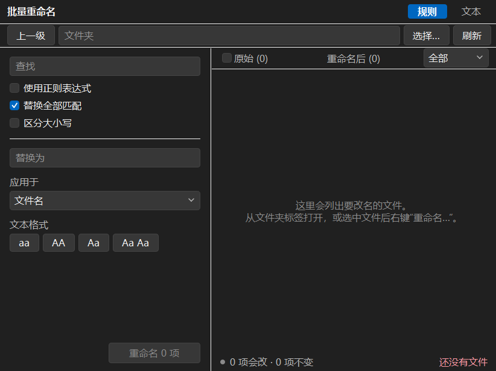
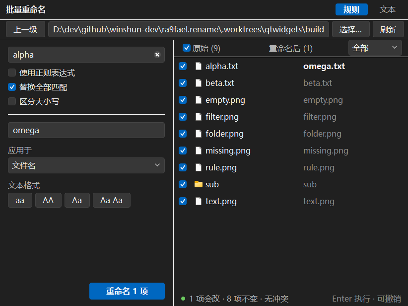
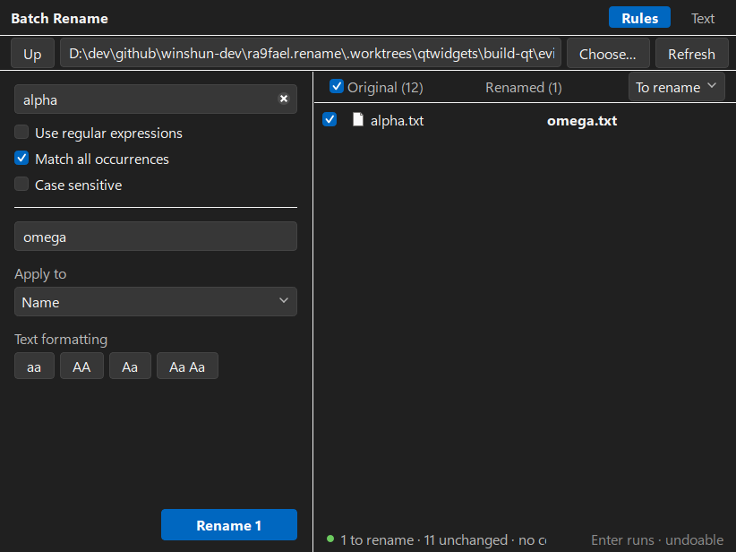

# rename: Qt Widgets experiment

Date: 2026-11-15. Branch: `exp/qtwidgets`, worktree
`D:\dev\github\winshun-dev\ra9fael.rename\.worktrees\qtwidgets`.
Base: the working tree at `main` (`c1ebb99`) plus the uncommitted changes that
were present when the experiment started.

## What changed

- Replaced the Qt Quick window (`Main.qml` / `qt_host.cpp`) with
  `ui/widgets_window.{h,cpp}` and a Widgets host in `ui/qt_host.cpp`.
- The core, `rename_ui::Presenter`, `Bridge` and the executor are unchanged;
  `Bridge::previewModel()` now exposes three table columns over the same rows.
- Text mode is a `QPlainTextEdit` over `Bridge::buffer()`. The oil buffer is
  parsed by the existing `Presenter`; `Ctrl+S` and the button run the batch.
- The table has a real filter (`全部 / 已选 / 可改 / 要改`) and a select-all
  checkbox. `Bridge::setFilter()` was already implemented but had no caller.
- The apply button asks for confirmation, with the ready/unchanged/blocked
  counts. Mode switching asks before discarding unexecuted edits.
- `Bridge::setSelection()` / `setFolder()` now clear the previous done line,
  blocked line, filter, mode and oil buffer; a missing root is shown as an error
  instead of an empty set. `reset()` clears the same state.
- Apply results are matched back by the full planned target path, not by a leaf
  suffix, so equal leaf names in different folders cannot be mixed up.
- `package/plugin.json` raises `memoryMB` from 128 to 256 as headroom. The
  measured window is now ~10 MB private, so the old 128 MB cap was not the real
  cause; the Unicode-symbol/font fallback below was.
- The window no longer uses `✎`/`⏷`-style Unicode glyphs: U+270E alone loaded
  Segoe UI Emoji/Symbol and cost ~119 MB private on this machine. Arrows and
  checkmarks are painted now.
- The CJK-capable font (`Microsoft YaHei UI`) is selected before any child
  widget is created; selecting it later was too late because layout had already
  populated Qt's fallback font cache.
- `tools/pack.ps1` bundles `Qt6Widgets.dll` when the exe imports it. Qt Widgets
  is not in WinShun's shared-Qt contract yet.
- The plugin is now **Batch Rename** only: `rename <pattern> -> <new>` and the
  single-file preview path were removed; WinShun's F2 remains the way to rename
  one file. The manifest name/title/keyword and menu title are localized.
- One selected path drives the batch: a folder lists its direct children, a file
  lists its siblings. A same-parent multi-selection opens exactly the selected
  items.
- A directory bar has `上一级` / `选择…` / `刷新`, an editable path and
  double-click-to-enter on folder rows.
- A missing line in the text buffer is a safe **skip** (`skipped`), not a
  delete; unknown/duplicate ids and malformed lines still block.
- The window has a `.ico` (RC + Qt resource) and follows the host locale on
  `appearanceChanged` through `Retranslate()`.
- The plugin no longer declares `winshun:search`; it does not query the index
  for the old single-file path.

The current WinShun host builds a file menu from `triggers.files` alone and has
no per-path predicate. Therefore a multi-selection in different folders still
shows the menu item; `action()` refuses it with "select one folder" instead of
guessing. Exact "only same folder shows" needs a host field, which this branch
does **not** change.

## Build and tests

```powershell
cmake -S . -B build-qt -G Ninja -DCMAKE_BUILD_TYPE=Release `
  -DRENAME_BUILD_QT=ON -DCMAKE_PREFIX_PATH=D:\tools\Qt\6.12.0\msvc2022_64
cmake --build build-qt --parallel
ctest --test-dir build-qt --output-on-failure
```

Result: `ctest` 4/4 passed (`rename_core`, `rename_e2e`, `core_purity`,
`action_payload`). The Qt build compiles `rename.exe`, `rename-ui.exe` and the
same Widgets target used by the plugin.

## Screenshots

| Empty window (instructions, not an error) | Rule mode |
|---|---|
|  |  |

| Text mode | Filter: to rename |
|---|---|
|  |  |

| Folder contents + navigation | Missing path (blocked, not "no files") |
|---|---|
|  |  |

| Selected row (readable text) | Skipped line (missing from text buffer) |
|---|---|
|  |  |

| English UI | Files trigger under the host Qt environment |
|---|---|
|  |  |

## Files trigger

A host-like process (same environment as `tools/host-sim.ps1`) started
`rename.exe`, answered `initialize`, then sent:

```json
{"method":"action","params":{"command":"rename","action":"files",
 "trigger":"files","files":["…\\alpha.txt","…\\beta.txt"],"item":{},"text":""}}
```

With one file it opens the file's parent directory, so the screenshot shows
both `alpha.txt` and `beta.txt`; the selected file is the reason for the
directory, not the only target. It answered `{"effects":[{"type":"hide"}]}`,
logged `[rename] files trigger: count=1`, and rendered at 822×616. The 128 MB
crash did not recur with the font/symbol fix and `memoryMB: 256`.

This is not the same as clicking the item in WinShun's GUI: the real host still
needs a package install with `Qt6Widgets.dll` beside the plugin exe (or Qt
Widgets added to the shared-Qt contract). The installed experimental package is
`dist/ra9fael.rename-0.2.0.wsplugin` (3,315,197 bytes, SHA-256
`fddbe9c0dd2756125f7b4f5dc6a70f722eff80fa2e4a9fc46f83cfe6f0e684ef`).

## Memory (this machine)

| Build | Working set | Private / commit | Notes |
|---|---:|---:|---|
| QML window, 128 MB cap | 324 MB peak (wrapper) | 164 MB commit at crash | `qBadAlloc`; also contained `✎`/`⏷` glyphs |
| Widgets, before glyph/font fix | 261 MB | 136 MB | same two rows |
| Widgets, final, two files | 50 MB | 12.5 MB | peak paged 27 MB |
| Widgets, final, Chinese filenames | 50 MB | 12.1 MB | peak paged 27 MB |
| Widgets under host Qt, files trigger | 42 MB | 7.3 MB | installed 0.2.0, single file → parent folder |

### Why the first Widgets number was wrong

A minimal Qt Widgets probe isolated the cost; these are private/commit numbers
on this machine:

| Probe | Private |
|---|---:|
| English labels, default font | 10 MB |
| Chinese labels, default font | 122 MB |
| Chinese labels, `Microsoft YaHei UI` selected up front | 9 MB |
| The same plus a `✎` label (U+270E) | 119 MB |
| The same plus `⏷` (U+23F7) | 54 MB |

So the high number was **not Qt Widgets**. Qt's fallback from a Latin-only font
to a CJK face, and from normal text to Segoe UI Emoji/Symbol for `✎`/`⏷`, loads
large font caches. The QML window used the same glyphs and the same Latin-only
family, so its 164 MB crash was likely the same effect plus the QML engine; that
QML combination was not retested. Win32 GDI is only the answer if the target is
"single-digit MB"; Widgets is already around 10 MB private after the fix.

## Not verified yet

- A real WinShun right-click click with this package (it is installed and
  enabled; the host-like process above is still not a menu click).
- Exact same-folder menu filtering: the current WinShun host has no per-path
  predicate, so the item appears for any multi-selection and `action()` rejects
  a cross-folder one. No WinShun source was changed.
- Light theme, 150/200 % DPI, screen reader, IME composition in the text editor.
- Clicking the table checkbox, the select-all box, the directory bar and
  double-click-to-enter with a mouse; the filter/selection/skip screenshots use
  diagnostic hooks.
- The confirmation dialog under the host's four themes.
- Rule chains (PowerRename-style) and Vim mode are not in this branch yet.

## Reproduce a screenshot

```powershell
$env:PATH = "D:\tools\Qt\6.12.0\msvc2022_64\bin;$env:PATH"
$env:QT_PLUGIN_PATH = "D:\tools\Qt\6.12.0\msvc2022_64\plugins"
$env:QT_QPA_PLATFORM_PLUGIN_PATH = "D:\tools\Qt\6.12.0\msvc2022_64\plugins\platforms"
$env:RENAME_GRAB_WINDOW = "$PWD\build-qt\rule.png"
$env:RENAME_GRAB_RULE = "alpha`nomega"
.\rename-ui.exe --files C:\tmp\alpha.txt C:\tmp\beta.txt
```
