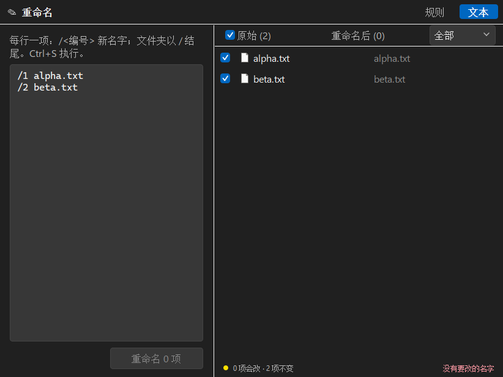

# rename: Qt Widgets experiment

Date: 2026-11-15. Branch: `exp/qtwidgets`, worktree
`D:\dev\github\winshun-dev\ra9fael.rename\.worktrees\qtwidgets`.
Base: the working tree at `main` (`c1ebb99`) plus the uncommitted changes that
were present when the experiment started.

## What changed

- Replaced the Qt Quick window (`Main.qml` / `qt_host.cpp`) with
  `ui/widgets_window.{h,cpp}` and a Widgets host in `ui/qt_host.cpp`.
- The core, `rename_ui::Presenter`, `Bridge` and the executor are unchanged;
  `Bridge::previewModel()` now exposes three table columns over the same rows.
- Text mode is a `QPlainTextEdit` over `Bridge::buffer()`. The oil buffer is
  parsed by the existing `Presenter`; `Ctrl+S` and the button run the batch.
- The table has a real filter (`全部 / 已选 / 可改 / 要改`) and a select-all
  checkbox. `Bridge::setFilter()` was already implemented but had no caller.
- The apply button asks for confirmation, with the ready/unchanged/blocked
  counts. Mode switching asks before discarding unexecuted edits.
- `Bridge::setSelection()` / `setFolder()` now clear the previous done line,
  blocked line, filter, mode and oil buffer; a missing root is shown as an error
  instead of an empty set. `reset()` clears the same state.
- Apply results are matched back by the full planned target path, not by a leaf
  suffix, so equal leaf names in different folders cannot be mixed up.
- `package/plugin.json` raises `memoryMB` from 128 to 512. The Qt Quick window
  crashed with `qBadAlloc` under the 128 MB job cap; see the earlier QML log.
- `tools/pack.ps1` bundles `Qt6Widgets.dll` when the exe imports it. Qt Widgets
  is not in WinShun's shared-Qt contract yet.

## Build and tests

```powershell
cmake -S . -B build-qt -G Ninja -DCMAKE_BUILD_TYPE=Release `
  -DRENAME_BUILD_QT=ON -DCMAKE_PREFIX_PATH=D:\tools\Qt\6.12.0\msvc2022_64
cmake --build build-qt --parallel
ctest --test-dir build-qt --output-on-failure
```

Result: `ctest` 4/4 passed (`rename_core`, `rename_e2e`, `core_purity`,
`action_payload`). The Qt build compiles `rename.exe`, `rename-ui.exe` and the
same Widgets target used by the plugin.

## Screenshots

| Rule mode | Text mode |
|---|---|
|  |  |

| Folder contents | Filter: to rename |
|---|---|
|  |  |

| Missing path (blocked, not "no files") | Files trigger under the host Qt environment |
|---|---|
|  |  |

## Files trigger

A host-like process (same environment as `tools/host-sim.ps1`) started
`rename.exe`, answered `initialize`, then sent:

```json
{"method":"action","params":{"command":"rename","action":"files",
 "trigger":"files","files":["…\\alpha.txt","…\\beta.txt"],"item":{},"text":""}}
```

It answered `{"effects":[{"type":"hide"}]}`, the plugin logged
`[rename] files trigger: count=2`, and the window rendered at 822×616. The
128 MB crash did not recur with `memoryMB: 512`.

This is not the same as clicking the item in WinShun's GUI: the real host still
needs a package install with `Qt6Widgets.dll` beside the plugin exe (or Qt
Widgets added to the shared-Qt contract).

## Memory (this machine)

| Build | Working set | Private / commit | Notes |
|---|---:|---:|---|
| QML window, 128 MB cap | 324 MB peak (wrapper) | 164 MB commit at crash | `qBadAlloc` in `QFontEngine::initializeHeightMetrics` |
| Widgets window, idle after 1.5 s | 261 MB | 136 MB | two rows, dark fluent tokens |
| Widgets under host Qt, two-file files trigger | 260 MB | 136 MB | sampled while the window was open |

Widgets remove the QML engine and scene graph, but the Qt GUI/font stack is
still the dominant cost. This is not a "tiny" build; Win32 GDI/DirectWrite is
the way to get there. The immediate job-cap problem is solved by 512 MB.

## Not verified yet

- A real WinShun right-click install/click with this package (the host-like
  process above is the closest so far).
- Light theme, 150/200 % DPI, screen reader, IME composition in the text editor.
- Clicking the table checkbox, the select-all box and the filter with a mouse;
  the filter screenshot used the `RENAME_GRAB_FILTER` diagnostic hook.
- The confirmation dialog's visual appearance under the host's four themes.
- The `.wsplugin` install/update path with the bundled `Qt6Widgets.dll`.

## Reproduce a screenshot

```powershell
$env:PATH = "D:\tools\Qt\6.12.0\msvc2022_64\bin;$env:PATH"
$env:QT_PLUGIN_PATH = "D:\tools\Qt\6.12.0\msvc2022_64\plugins"
$env:QT_QPA_PLATFORM_PLUGIN_PATH = "D:\tools\Qt\6.12.0\msvc2022_64\plugins\platforms"
$env:RENAME_GRAB_WINDOW = "$PWD\build-qt\rule.png"
$env:RENAME_GRAB_RULE = "alpha`nomega"
.\rename-ui.exe --files C:\tmp\alpha.txt C:\tmp\beta.txt
```
